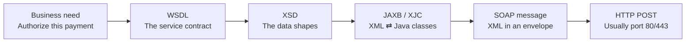
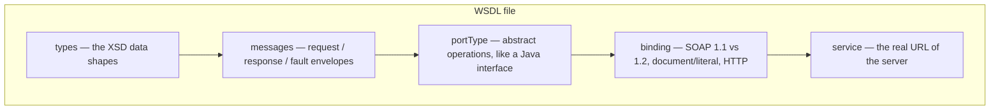
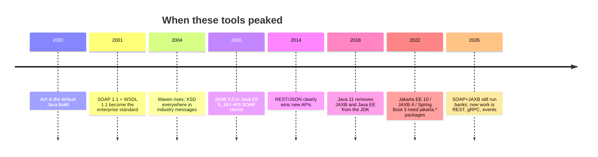

# 01 — Concepts: SOAP, WSDL, XSD, JAXB, Ant and Gradle

If you already know REST + JSON, think of this stack as **the older, more formal way two companies talked over HTTP**. Same internet, stricter paperwork.



---

## Real-world picture first

Imagine two banks. Bank A wants Bank B to say *yes* or *no* to a transfer.

They cannot “just send JSON and hope”. Lawyers, auditors, and mainframes want a **signed contract**:

| Everyday thing | Tech equivalent |
|----------------|-----------------|
| The legal agreement: “we offer this service, at this address, with these errors” | **WSDL** |
| The form fields on the agreement: amount must be a number, currency must be 3 letters | **XSD** |
| The filled-in form stuffed in a standard envelope with a return address | **SOAP** |
| A clerk who copies the form into your internal filing system (Java objects) and back | **JAXB** |
| The code generator that prints Java filing templates from the agreement | **XJC** |

REST/JSON is more like a text message: fast, flexible, easy to break if someone renames a field. SOAP/XML is more like a registered letter.

---

## SOAP — Simple Object Access Protocol

**What it is.** A rule for wrapping XML in a standard envelope and sending it over HTTP (usually `POST`). A SOAP message looks like:

```xml
<soap:Envelope>
  <soap:Header><!-- optional security, tracing --></soap:Header>
  <soap:Body>
    <TransactionAuthorizationRequest>
      <AccountNumber>DE89370400440532013000</AccountNumber>
      <Amount>250.00</Amount>
      <Currency>EUR</Currency>
    </TransactionAuthorizationRequest>
  </soap:Body>
</soap:Envelope>
```

**When it was popular.** Peak years roughly **2001–2012**. Microsoft, IBM, Oracle, and Sun pushed it as “web services” (WS-\*). Every enterprise ESB (Enterprise Service Bus — a company-wide message switchboard) spoke SOAP.

**Are people still using it?** Yes, but it is **legacy-dominant, not new-project-dominant**.

- Still common in **banking, insurance, telecom, government, SAP, Oracle, IBM MQ/ESB**.
- Almost never chosen for a **new** public API. Those are REST, GraphQL, or gRPC.
- You meet SOAP when you **integrate with a system that already exists**.

**Why it felt heavy.** XML is verbose. WS-Security, WS-Addressing, and WSDL versioning made simple calls look like legal documents. JSON + OpenAPI won for greenfield work because humans can read them in five minutes.

**SOAP vs REST in one table**

| | SOAP (this world) | REST/JSON (what you likely use) |
|---|---|---|
| Payload | XML envelope | JSON body |
| Contract | WSDL + XSD | OpenAPI / informal |
| Transport | Usually HTTP POST only | GET/POST/PUT/PATCH/DELETE |
| Errors | SOAP Fault | HTTP status + JSON error |
| Typical year you learn it | 2005 | 2015+ |

This POC **does not send a real SOAP envelope**. It only uses the **types** that a SOAP service would have used. The mock lives behind REST so you can curl it easily.

---

## WSDL — Web Services Description Language

**What it is.** An XML file that describes a SOAP service the way OpenAPI describes a REST API.

A WSDL has layers. Read them top to bottom like a building:



In this repo that file is [`wsdl/ESBTransactionAuthorization_v1_0.wsdl`](../wsdl/ESBTransactionAuthorization_v1_0.wsdl).

It says:

- There is one operation: `AuthorizeTransaction`
- Input is `TransactionAuthorizationRequest`
- Output is `TransactionAuthorizationResponse`
- Errors use `AuthorizationFault`
- The (dummy) address is `http://esb.consorsbank.de/services/TransactionAuthorizationService/v1`

**When it was popular.** Same era as SOAP. Tools like **SoapUI**, **IBM Integration Bus**, and **wsimport** lived on WSDL.

**Still used?** Yes, wherever SOAP is used. New teams rarely write a WSDL by hand. They inherit one from a vendor.

**Important for this project.** **XJC cannot compile a full WSDL.** XJC only understands XSD. That is why we extracted the `<wsdl:types>` block into a standalone `.xsd` file.

If you needed a full SOAP **client stub** (a Java interface you can call like `port.authorizeTransaction(req)`), you would use:

- `wsimport` — bundled in the JDK until **Java 10**, **removed in Java 11**
- Apache CXF `wsdl2java`
- JAX-WS Metro `wsdl2java`

This POC stops at **model classes**, on purpose.

---

## XSD — XML Schema Definition

**What it is.** A grammar for XML. It answers: which tags exist, which are required, what type they are, and in which order.

REST analogy: XSD is to XML what **JSON Schema / OpenAPI `components.schemas`** is to JSON.

Example from this project:

```xml
<xsd:element name="Amount" type="xsd:decimal" minOccurs="1" maxOccurs="1"/>
<xsd:simpleType name="CurrencyCodeType">
  <xsd:restriction base="xsd:string">
    <xsd:pattern value="[A-Z]{3}"/>
  </xsd:restriction>
</xsd:simpleType>
```

That means: `Amount` is required and numeric. `Currency` must look like `EUR`, not `euro`.

**When it was popular.** Mid-2000s, everywhere XML was used: SOAP, config files, industry standards (ISO 20022 in payments, HL7 in healthcare, ACORD in insurance).

**Still used?** Heavily in **regulated messaging**. ISO 20022 payment messages are still XSD. Many government e-invoicing formats are XSD. For public JSON APIs, people prefer JSON Schema.

In this repo the extracted schema is [`wsdl/ESBTransactionAuthorization_v1_0.xsd`](../wsdl/ESBTransactionAuthorization_v1_0.xsd). **That file is the real input to code generation.**

---

## JAXB — Jakarta XML Binding (formerly Java Architecture for XML Binding)

**What it is.** A Java standard that maps XML ⇄ Java objects using annotations.

Two directions:

| Word | Meaning |
|------|---------|
| **Unmarshal** | XML string → Java object |
| **Marshal** | Java object → XML string |
| **XJC** | The compiler that reads an XSD and **writes** the Java classes for you |

Without JAXB you would hand-write POJOs and parse XML with `DocumentBuilder`. JAXB generates:

- `TransactionAuthorizationRequestType` — a POJO with getters/setters
- `AuthorizationStatusType` — an enum (`APPROVED`, `DECLINED`, `PENDING`, `ERROR`)
- `ObjectFactory` — factory methods JAXB uses internally
- `package-info.java` — namespace metadata

**Naming quirk you will hit.** XSD `complexType` names become Java classes. Global `element` names become `JAXBElement<...>` wrappers in `ObjectFactory`. Application code in this POC uses the `*Type` classes directly.

**When it was popular.** JAXB 1.0 ~2003, JAXB 2.0 with Java EE 5 (~2006). From **Java 6 through Java 10**, JAXB shipped **inside the JDK**. Developers imported `javax.xml.bind` and it just worked.

**What broke.** Starting with **Java 11 (2018)**, Oracle removed Java EE APIs from the JDK. JAXB is no longer “free with Java”. You add it as a Maven/Gradle dependency.

**Jakarta rename.** Java EE became **Jakarta EE**. Package `javax.xml.bind` became `jakarta.xml.bind`. Mixing the two on one classpath is a classic `ClassNotFoundException`. This project uses **Jakarta JAXB 4.x** (`jakarta.xml.bind-api` 4.0.5 + `org.glassfish.jaxb:jaxb-runtime` / `jaxb-xjc` 4.0.9), which matches **Jakarta EE 10** and **Spring Boot 4.0.8**.

**Still used?** Yes, whenever Java talks to XML contracts. New JSON APIs use Jackson. XML/SOAP integrations still use JAXB (or XMLBeans, or CXF’s databinding). It is not trendy. It is still the default in a lot of banks.

---

## Apache Ant and Gradle

**What it is.** A 2000-era Java build tool. You write `build.xml` with targets like `compile`, `jar`, `xjc`. Tasks are XML; there is no real dependency graph like Gradle.

**When it was popular.** **~2000–2012**. Almost every Java shop used Ant, then many moved to Maven (~2004 onward), then Gradle.

**Still used?** Ant still appears in:

- Old enterprise code generators (JAXB XJC has a first-class **Ant task**: `com.sun.tools.xjc.XJCTask`)
- Places that never migrated the “generate sources” step even after the app itself moved to Maven/Gradle
- Legacy projects and build steps that already depend on Ant task definitions

Ant and XJC are distinct: XJC is the schema compiler, and Ant is one way to invoke it. Gradle can also run XJC through a dedicated Gradle plugin or a Java execution task. This project previously called XJC through Gradle's embedded AntBuilder; the current build has replaced that integration with the `com.github.bjornvester.xjc` Gradle plugin:

```
Gradle XJC plugin task
    → XJC 4.0.9
    → Java sources under build/generated-sources/jaxb
    → compileJava
```

Gradle owns the whole build and generation workflow. Ant is discussed here as a common legacy way to launch XJC; it is no longer used by this repository's build.

---

## Timeline — popularity vs today



**Short answers you can give in a standup**

- SOAP: old formal HTTP+XML. Still in banks. Not for new public APIs.
- WSDL: the SOAP equivalent of OpenAPI.
- XSD: the schema language inside the WSDL.
- JAXB: Java XML databinding. Still needed. Must be a dependency since Java 11.
- Ant: mature legacy build tool. This repository now invokes XJC through a Gradle plugin instead.

Next: [02 — Architecture](02-architecture.md).
