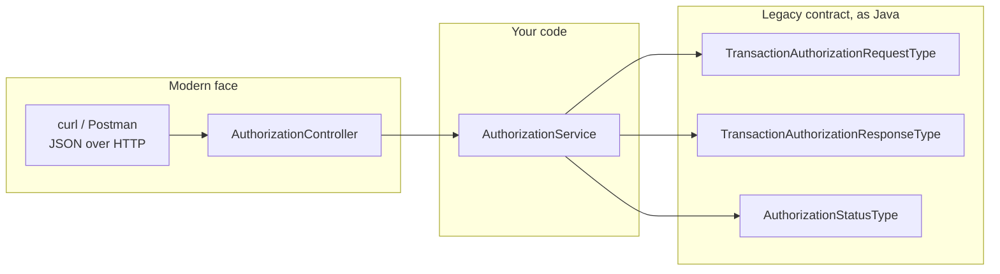
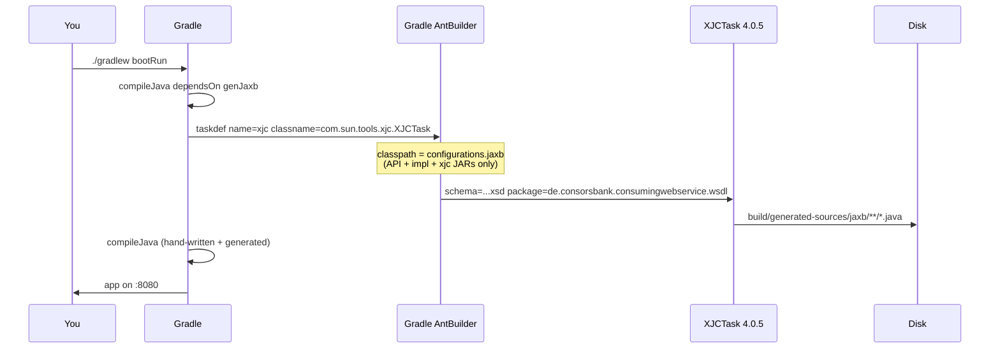
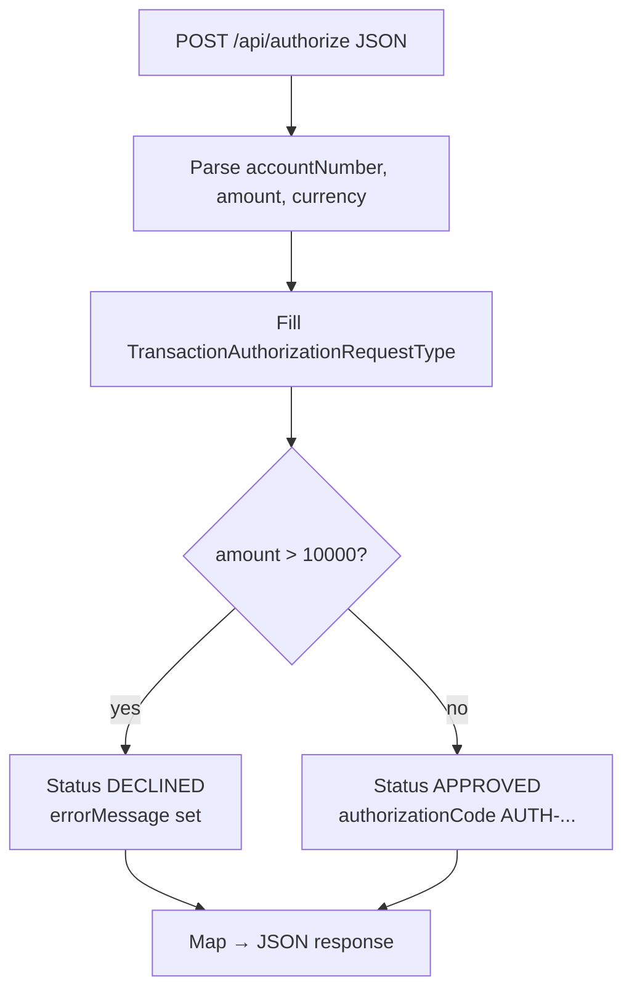
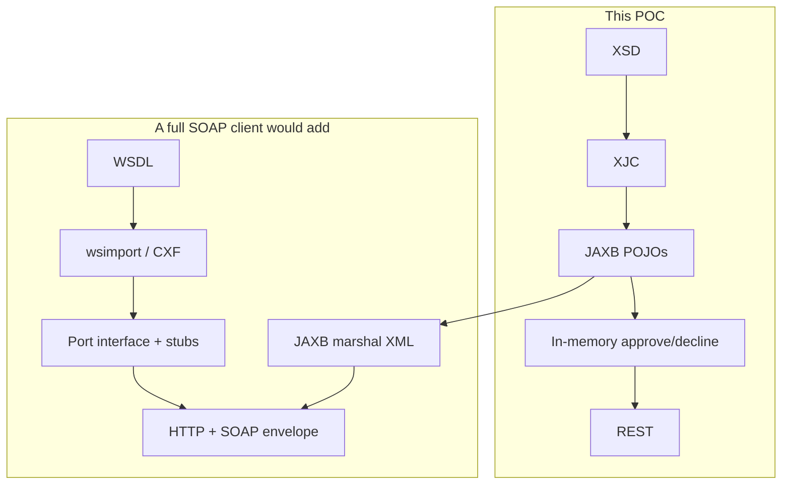

# 02 — How this project is put together

## What you are looking at

A **proof of concept**, not a production payment engine.

| It does | It does not |
|---------|-------------|
| Generate JAXB classes from the ESB XSD using **Ant XJC** | Call the real Consorsbank ESB |
| Compile those classes with **Java 21** and **Spring Boot 3.4** | Generate full SOAP client stubs |
| Expose REST JSON so you can prove the classes work | Send or receive a SOAP envelope on the wire |
| Mock approve/decline using the generated types | Persist anything or talk to a database |

Package: `de.consorsbank.consumingwebservice` (the original Spring “consuming a web service” sample shape).

---

## Mental model: two worlds in one process



The controller speaks **JSON** because that is easy to demo. The service speaks **JAXB types** because that is what a real SOAP integration would use before marshalling to XML.

In production you would typically:

1. Build `TransactionAuthorizationRequestType`
2. `JAXBContext` marshal it into XML
3. Wrap it in a SOAP envelope
4. POST to the ESB URL from the WSDL
5. Unmarshal the XML response back into `TransactionAuthorizationResponseType`

This POC skips steps 2–4 and invents the response in Java. That is enough to prove generation + compilation + runtime.

---

## Folder map

```
Springboot-JAXB-POC/
├── wsdl/
│   ├── ESBTransactionAuthorization_v1_0.wsdl   ← full dummy contract (documentation + future SOAP)
│   └── ESBTransactionAuthorization_v1_0.xsd    ← extracted schema; THIS is XJC input
├── src/main/java/.../
│   ├── Application.java                        ← Spring Boot entry
│   ├── controller/AuthorizationController.java ← REST
│   └── service/AuthorizationService.java       ← uses generated types
├── src/main/resources/application.yml          ← port 8080
├── src/test/java/.../ApplicationTest.java
├── build.gradle                                ← genJaxb Ant task lives here
└── build/generated-sources/jaxb/...            ← created at build time, do not edit
```

Generated sources are **not** committed as the source of truth. They appear after `./gradlew genJaxb` or any compile. Treat them like “compiler output you can read”.

---

## The Ant-based generation path (the important bit)

Legacy banks often had a `build.xml` like:

```xml
<taskdef name="xjc" classname="com.sun.tools.xjc.XJCTask" classpathref="jaxb.classpath"/>
<xjc schema="foo.xsd" destdir="gen" package="com.bank.wsdl"/>
```

This project does the **same Ant task**, launched from Gradle so you do not maintain a separate Ant project.



Why a separate Gradle configuration named `jaxb`?

- XJC is a **build tool**, not part of the running bank app.
- Putting XJC JARs only on `configurations.jaxb` keeps the Spring runtime classpath clean.
- The old `javax.xml.bind:jaxb-api` is **excluded** so it cannot sneak in next to `jakarta.xml.bind`.

Key `build.gradle` settings:

| Setting | Value | Why |
|---------|--------|-----|
| `schema` | `wsdl/ESBTransactionAuthorization_v1_0.xsd` | XJC is an XSD compiler |
| `destdir` | `build/generated-sources/jaxb` | Gradle `main` Java source dir |
| `package` | `de.consorsbank.consumingwebservice.wsdl` | Stable import path for the service |
| `extension` | `true` | Vendor extensions / Jakarta-friendly generation |
| `compileJava.dependsOn genJaxb` | producer → consumer | Compile never runs on a missing model |

The `idea {}` block marks that folder as a **Generated Sources Root** so IntelliJ can navigate into `TransactionAuthorizationRequestType`.

---

## Runtime logic (the mock “ESB”)

`AuthorizationService.authorize(...)`:

1. New `TransactionAuthorizationRequestType`
2. Fill `transactionId` (UUID), account, amount, currency, XML timestamp
3. New `TransactionAuthorizationResponseType` with the same id
4. **If amount > 10_000 → `DECLINED`** with error text  
   **Else → `APPROVED`** with `AUTH-xxxxxxxx`
5. Return the JAXB response object

The controller copies fields into a `Map` so Jackson can serialize JSON **without** a JAXB module. That is a demo shortcut. A SOAP client would marshal the object to XML instead.



`GET /api/health` only does `new TransactionAuthorizationRequestType()`. If that class is missing from the classpath, the app would not even compile — so a 200 here is a cheap runtime proof.

---

## XSD → Java mapping in this repo

| XSD | Java |
|-----|------|
| `complexType TransactionAuthorizationRequestType` | class `TransactionAuthorizationRequestType` |
| `element TransactionAuthorizationRequest` | `ObjectFactory.createTransactionAuthorizationRequest(...)` |
| `simpleType AuthorizationStatusType` enumerations | enum `AuthorizationStatusType` |
| `xsd:decimal` | `java.math.BigDecimal` |
| `xsd:dateTime` | `javax.xml.datatype.XMLGregorianCalendar` |
| `xsd:string` | `String` |
| `CurrencyCodeType` pattern `[A-Z]{3}` | still a `String` (XJC does not always generate a dedicated type for simple restrictions) |

`XMLGregorianCalendar` looks alien if you only know `Instant`. It exists because XML Schema date/time is not the same as `java.time`. The service converts `ZonedDateTime.now()` through `DatatypeFactory`.

---

## Why not call this a SOAP client?

Because these pieces are **missing**:

- HTTP call to the WSDL `soap:address`
- SOAP envelope wrap/unwrap
- `AuthorizeTransaction` port interface
- Fault mapping to `AuthorizationFaultType` on the wire

Those come from **JAX-WS / CXF**, not from JAXB alone. JAXB is the **payload** layer. JAX-WS is the **phone call** layer.



---

## Versions (so you do not mix eras)

| Piece | Version | Era it belongs to |
|-------|---------|-------------------|
| Java toolchain | 21 | Current LTS |
| Spring Boot | 3.4.0 | Jakarta EE, not Java EE |
| `jakarta.xml.bind-api` | 4.0.2 | Jakarta EE 10 |
| `jaxb-impl` / `jaxb-xjc` | 4.0.5 | Same family as the API |
| Ant | Gradle’s embedded AntBuilder | Legacy generation style |

If someone adds `javax.xml.bind:jaxb-api` “because a blog from 2017 said so”, the generator can fail. That is why `build.gradle` excludes it.

Next: [03 — How to run](03-how-to-run.md).
