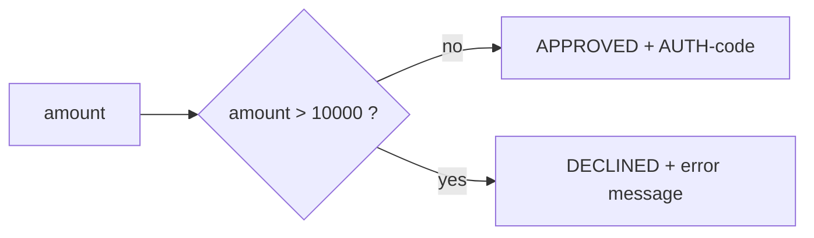

# 03 — How to run, input, and output

## Prerequisites

- **JDK 21** (Gradle toolchain will try to fetch it if your wrapper can; having 21 installed is simpler)
- Internet the first time (Maven Central for dependencies)
- `curl` or Postman (optional)

From the **project root** (the folder that contains `build.gradle`).

---

## Generate classes only

```bash
./gradlew genJaxb
```

Expected: `.java` files under

`build/generated-sources/jaxb/de/consorsbank/consumingwebservice/wsdl/`

You should see at least:

- `TransactionAuthorizationRequestType.java`
- `TransactionAuthorizationResponseType.java`
- `AuthorizationStatusType.java`
- `AuthorizationFaultType.java`
- `ObjectFactory.java`
- `package-info.java`

Re-run is cheap. Gradle skips the task if the XSD and that output folder are unchanged (`UP-TO-DATE`).

---

## Tests (best first check)

```bash
./gradlew test
```

This compiles generated sources, starts a Spring context, and runs:

| Test | Input | Expected |
|------|--------|----------|
| `contextLoads` | — | `AuthorizationService` bean exists |
| `authorizeApprovedTransaction` | IBAN, `100.00`, `EUR` | `APPROVED`, code starts with `AUTH-` |
| `authorizeDeclinedHighValueTransaction` | IBAN, `50000.00`, `EUR` | `DECLINED`, `errorMessage` not blank |

---

## Run the app

```bash
./gradlew bootRun
```

Listens on **http://localhost:8080** (`application.yml`).

Or build a jar:

```bash
./gradlew bootJar
java -jar build/libs/springboot-jaxb-poc-0.0.1-SNAPSHOT.jar
```

---

## Endpoints

### 1. Health — “are JAXB classes on the classpath?”

**Request**

```bash
curl -s http://localhost:8080/api/health
```

**Expected output (shape)**

```json
{
  "status": "UP",
  "jaxbClassLoaded": "de.consorsbank.consumingwebservice.wsdl.TransactionAuthorizationRequestType",
  "message": "JAXB-generated class 'TransactionAuthorizationRequestType' is available on the runtime classpath",
  "generatedBy": "XJC 4.0.5 via Apache Ant (Gradle genJaxb task)"
}
```

If generation failed, you never get this far: `compileJava` would have failed on imports in `AuthorizationService`.

---

### 2. Authorize — mock decision using JAXB types

**Request**

```http
POST /api/authorize
Content-Type: application/json
```

**JSON body (all three fields used)**

| Field | Type | Required | Meaning |
|-------|------|----------|---------|
| `accountNumber` | string | yes | Payer IBAN / account. Not validated beyond “present”. |
| `amount` | number | yes | Transaction amount. **Rule: greater than 10000 is declined.** |
| `currency` | string | yes | Intended as ISO 4217 (`EUR`). The REST layer does not enforce the XSD `[A-Z]{3}` pattern. |

Example approved call:

```bash
curl -s -X POST "http://localhost:8080/api/authorize" \
  -H "Content-Type: application/json" \
  -d '{"accountNumber":"DE89370400440532013000","amount":250.00,"currency":"EUR"}'
```

**Expected output (approved)**

```json
{
  "transactionId": "3f2a…-uuid…",
  "authorizationStatus": "APPROVED",
  "authorizationCode": "AUTH-A1B2C3D4",
  "responseTimestamp": "2026-11-08T14:22:01.123+01:00",
  "errorMessage": null
}
```

- `transactionId` is a new UUID created in the service (not taken from the JSON).
- `authorizationCode` is `AUTH-` plus 8 hex chars.
- `responseTimestamp` is XML Schema dateTime (`XMLGregorianCalendar.toXMLFormat()`).

Example declined call:

```bash
curl -s -X POST "http://localhost:8080/api/authorize" \
  -H "Content-Type: application/json" \
  -d '{"accountNumber":"DE89370400440532013000","amount":50000,"currency":"EUR"}'
```

**Expected output (declined)**

```json
{
  "transactionId": "…uuid…",
  "authorizationStatus": "DECLINED",
  "authorizationCode": null,
  "responseTimestamp": "2026-11-08T14:22:01.123+01:00",
  "errorMessage": "Amount exceeds per-transaction limit"
}
```

---

## Decision table (the only business rule)



| amount | status | authorizationCode | errorMessage |
|--------|--------|-------------------|--------------|
| `10` | `APPROVED` | `AUTH-…` | `null` |
| `10000` | `APPROVED` | `AUTH-…` | `null` |
| `10000.01` | `DECLINED` | `null` | Amount exceeds per-transaction limit |
| `50000` | `DECLINED` | `null` | Amount exceeds per-transaction limit |

Statuses `PENDING` and `ERROR` exist on the generated enum because the **XSD** defines them. The mock never sets them.

---

## What a *real* SOAP input would look like

You do **not** POST this to `:8080`. It is here so you can see the contract the XSD describes.

```xml
<soap:Envelope xmlns:soap="http://www.w3.org/2003/05/soap-envelope"
               xmlns:tns="http://consorsbank.de/esb/transactionauthorization/v1">
  <soap:Body>
    <tns:TransactionAuthorizationRequest>
      <tns:TransactionId>11111111-1111-1111-1111-111111111111</tns:TransactionId>
      <tns:AccountNumber>DE89370400440532013000</tns:AccountNumber>
      <tns:Amount>250.00</tns:Amount>
      <tns:Currency>EUR</tns:Currency>
      <tns:RequestTimestamp>2026-11-08T14:22:01+01:00</tns:RequestTimestamp>
    </tns:TransactionAuthorizationRequest>
  </soap:Body>
</soap:Envelope>
```

JAXB’s job in a real client would be: Java object ↔ that inner XML. SOAP’s job would be: wrap it, POST it, unwrap the reply.

---

## Common failures

| Symptom | Likely cause |
|---------|----------------|
| `cannot find symbol TransactionAuthorizationRequestType` | `genJaxb` did not run; check `compileJava.dependsOn genJaxb` |
| XJC / `ClassNotFoundException` around `javax.xml.bind` | Old JAXB API on the tool classpath |
| App starts but you use another port | Something else bound `8080`; check `application.yml` |
| `NullPointerException` on `amount` | JSON body missing `amount` — controller does `body.get("amount").toString()` with no validation |

---

## Useful Gradle tasks

```bash
./gradlew tasks --group "code generation"
./gradlew genJaxb
./gradlew clean test
./gradlew bootRun
```

`clean` deletes `build/`, including generated JAXB sources. The next compile regenerates them.

Back to the [docs index](README.md) or open the [interactive guide](interactive-guide.html).
