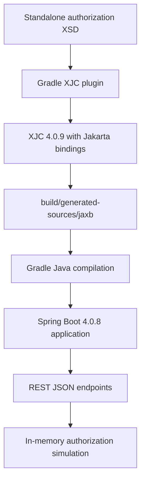

# Spring Boot 4.0.8 and Gradle XJC Plugin Migration

This note describes the repository's current build setup after the move to Spring Boot 4.0.8 and replacement of the embedded Ant XJC invocation with a dedicated Gradle XJC plugin.

## Summary

The application uses Java 21, Spring Boot 4.0.8 and Gradle 8.14.6. JAXB remains Jakarta JAXB 4.0. XJC still generates the same schema-bound Java model types from the standalone XSD, but a Gradle plugin now owns that generation task. The build no longer uses `ant.taskdef`, `ant.xjc`, or a custom `jaxb` tool configuration.

The migration changes build integration; it does not turn the application into a SOAP client. The runtime still exposes REST/JSON and simulates authorization locally.

## What changed

| Area | Previous setup | Current setup | Reason |
|---|---|---|---|
| Spring Boot plugin | 3.4.0 | 4.0.8 | Move the application to the Boot 4 generation |
| Spring dependency management plugin | 1.1.6 | 1.1.7 | Keep the Gradle dependency-management integration current with the project upgrade |
| Web starter | `spring-boot-starter-web` | `spring-boot-starter-webmvc` | Use Boot 4's focused MVC starter |
| Test starter | `spring-boot-starter-test` | `spring-boot-starter-webmvc-test` | Use Boot 4's technology-specific MVC test starter |
| Gradle wrapper | 8.11 | 8.14.6 | Meet the Gradle baseline for Spring Boot 4 |
| JAXB API/provider | Explicit Jakarta JAXB 4 artifacts | Boot BOM-managed Jakarta API 4.0.5 and JAXB RI 4.0.9 | Keep runtime API/provider versions aligned with Boot's dependency management |
| XJC integration | Handwritten Gradle task + embedded Ant `taskdef` | `com.github.bjornvester.xjc` Gradle plugin 1.9.1 | Let a Gradle plugin manage XJC invocation, generated source integration and task inputs/outputs |
| XJC version | 4.0.5 / previous project setup | 4.0.9 | Align generator with the JAXB RI version managed by the Boot 4 BOM |

Java 21 remains the selected toolchain. The WSDL and XSD contracts remain unchanged. The generated source output remains `build/generated-sources/jaxb`, so Java imports and the documented output layout are preserved.

## Why remove Ant from this build?

Ant was not required by Spring Boot. It was used because the build called the XJC Ant task directly:

```groovy
ant.taskdef(name: 'xjc', classname: 'com.sun.tools.xjc.XJCTask', ...)
ant.xjc(schema: ..., destdir: ..., package: ...)
```

That is a valid legacy integration, but it exposes Ant-specific wiring in a Gradle-owned build: the task class name, classpath string, Ant task registration and hand-maintained source/task wiring. The dedicated plugin removes that AntBuilder layer and provides a Gradle-oriented XJC configuration. The plugin documents Jakarta JAXB 4 support, Gradle 8.14 compatibility, and Gradle build/configuration cache support. This project has not enabled the Gradle build cache, and configuration cache remains explicitly disabled in `gradle.properties`; plugin support does not enable either setting by itself. It is a community plugin, so the project is also accepting that plugin's maintenance and supply-chain lifecycle as a dependency.

Ant remains a reasonable choice when a team already has Ant tasks or must preserve a shared legacy `build.xml` workflow. For this one-schema Gradle project, the plugin keeps the build configuration focused on the XSD-to-Java task.

## Current `build.gradle` configuration

The plugin declaration is in the top-level `plugins` block:

```groovy
plugins {
    id 'java'
    id 'org.springframework.boot' version '4.0.8'
    id 'io.spring.dependency-management' version '1.1.7'
    id 'com.github.bjornvester.xjc' version '1.9.1'
}
```

The `xjc` extension configures generation:

```groovy
xjc {
    xsdDir.set(layout.projectDirectory.dir('wsdl'))
    includes.set(['ESBTransactionAuthorization_v1_0.xsd'])
    outputJavaDir.set(layout.buildDirectory.dir('generated-sources/jaxb'))
    useJakarta.set(true)
    xjcVersion.set('4.0.9')
    defaultPackage.set('de.consorsbank.consumingwebservice.wsdl')
    addCompilationDependencies.set(false)
    options.add('-extension')
}
```

| Setting | Effect |
|---|---|
| `xsdDir` + `includes` | Select only the standalone authorization XSD. The WSDL is not passed to XJC. |
| `outputJavaDir` | Preserve the generated-source location expected by this repository. |
| `useJakarta` | Generate `jakarta.xml.bind` metadata, consistent with Boot 4 and JAXB 4. |
| `xjcVersion` | Pin the build-time compiler to 4.0.9, matching the managed JAXB RI line. |
| `defaultPackage` | Preserve the package imported by handwritten services/controllers. |
| `addCompilationDependencies = false` | Avoid a second API declaration; the application already declares the JAXB API version managed by Boot's BOM. |
| `options.add('-extension')` | Preserve the prior XJC extension option. |

The plugin integrates its generated sources with Java compilation. A small `genJaxb` lifecycle alias depends on the plugin's `xjc` task so existing commands and docs can continue to use `./gradlew genJaxb`.

The runtime dependencies remain intentionally explicit by role:

```groovy
implementation 'jakarta.xml.bind:jakarta.xml.bind-api'
runtimeOnly 'org.glassfish.jaxb:jaxb-runtime'
```

The first provides the public JAXB API. The second provides the JAXB RI implementation if runtime binding is used. The plugin brings the XJC compiler on its isolated generation classpath; XJC is not an application runtime dependency.

## Build and runtime flow now



The build-time code generation task reads the schema and writes Java source. At runtime, the current application creates generated request/response objects and returns a JSON representation. It does not marshal a SOAP body, create a SOAP envelope, call the WSDL address, or unmarshal a SOAP response.

## Why use a separate JAXB API and runtime?

- `jakarta.xml.bind-api` is needed to compile generated annotations and JAXB application APIs.
- `jaxb-runtime` is the actual JAXB provider used when `JAXBContext` or marshal/unmarshal operations run.
- XJC is a build tool and belongs on the plugin/generator side rather than the app's runtime classpath.
- Boot's dependency management supplies compatible JAXB patch versions; avoid adding `javax.xml.bind` JAXB 2 artifacts to this Jakarta JAXB 4 setup.

Note that `javax.xml.datatype.XMLGregorianCalendar` in generated source is a Java SE XML datatype package. It is not the legacy `javax.xml.bind` API and should not be renamed during JAXB namespace migrations.

## Commands

Generate JAXB sources only:

```bash
./gradlew genJaxb
```

Run application compilation and packaging:

```bash
./gradlew clean bootJar
```

Run the application locally:

```bash
./gradlew bootRun
```

`clean` removes `build/`, including generated source output. The next XJC/compile task recreates it.

## Verification performed

- `./gradlew genJaxb` completed successfully and generated the six expected JAXB source files.
- `./gradlew compileJava` completed successfully. Gradle reported the `xjc` task `UP-TO-DATE`, confirming the generated source output was recognized and wired into compilation.
- The test suite was not run as part of this build-integration change.

## Migration considerations and caveats

1. **Spring Boot 4 does not itself require this XJC plugin.** The plugin is a build-time choice; Boot 4 requires a compatible Gradle baseline and the Jakarta application stack.
2. **The plugin is community-maintained.** Review its releases, issue activity, compatibility and dependency security as part of normal build dependency review.
3. **Keep the source contract authoritative.** Generated source is build output; modify the XSD or XJC configuration rather than editing generated Java.
4. **XJC generates models, not a full SOAP client.** WSDL operations and transport remain outside the current generation pipeline. A future actual SOAP client would use a WSDL-aware tool/framework such as CXF/Metro.
5. **Dependency namespaces must agree.** Generated annotations, compile API and runtime provider must all use Jakarta JAXB. Do not combine these types with `javax.xml.bind` classes.

## References

- [XJC Gradle plugin repository and configuration](https://github.com/bjornvester/xjc-gradle-plugin)
- [XJC Gradle plugin on the Gradle Plugin Portal](https://plugins.gradle.org/plugin/com.github.bjornvester.xjc)
- [Spring Boot 4 upgrade notes](https://github.com/spring-projects/spring-boot/wiki/Spring-Boot-4.0-Migration-Guide)
- [Spring Boot system requirements](https://docs.spring.io/spring-boot/system-requirements.html)
- [Jakarta XML Binding 4.0 specification](https://jakarta.ee/specifications/xml-binding/4.0/jakarta-xml-binding-spec-4.0)

