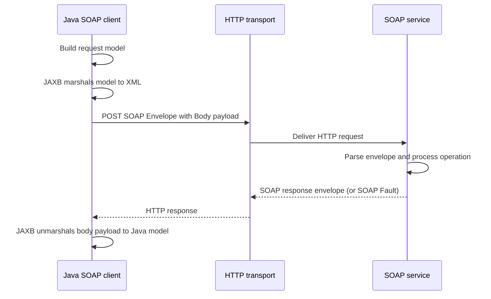
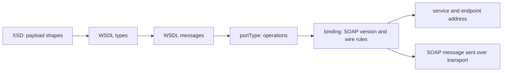
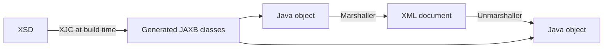
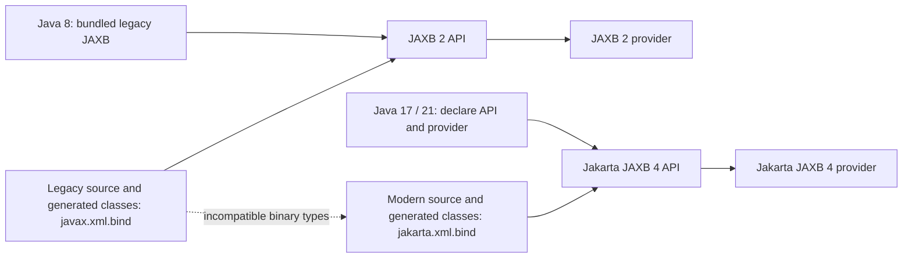
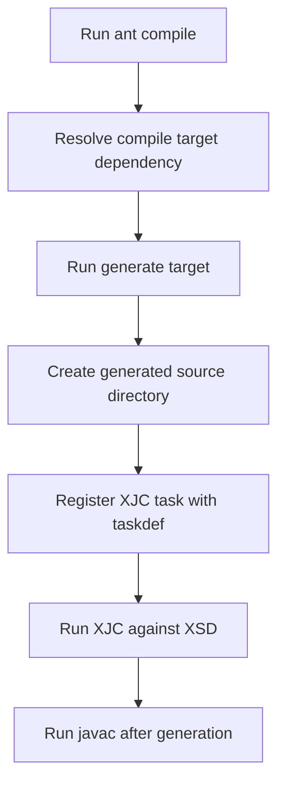
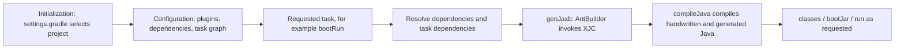
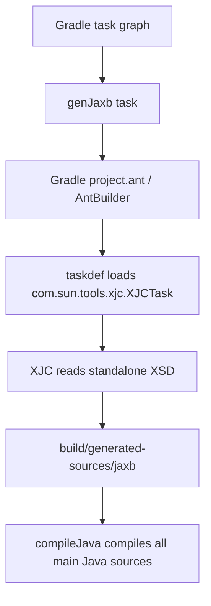
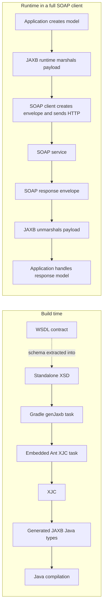
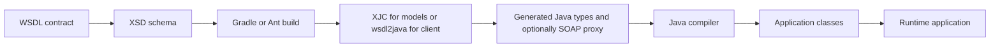

# SOAP, WSDL, XSD, JAXB, Ant and Gradle: A Project-Based Learning Guide

This guide starts with the contract and follows it into generated Java types and application code. It uses this repository as the primary example and clearly marks examples that are not implemented here.

## Contents

- [1. What this repository actually does](#1-what-this-repository-actually-does)
- [2. SOAP](#2-soap)
- [3. WSDL](#3-wsdl)
- [4. XSD](#4-xsd)
- [5. JAXB](#5-jaxb)
- [6. javax.xml.bind and jakarta.xml.bind](#6-javaxxmlbind-and-jakartaxmlbind)
- [7. Ant and Gradle](#7-ant-and-gradle)
- [8. How the pieces fit together](#8-how-the-pieces-fit-together)
- [9. Project walkthrough and examples](#9-project-walkthrough-and-examples)
- [10. Comparisons and troubleshooting reference](#10-comparisons-and-troubleshooting-reference)
- [11. Further reading](#11-further-reading)

## 1. What this repository actually does

The project is a Java 21, Spring Boot 3.4.0 application built by Gradle 8.11. Its core demonstration is **schema-to-Java code generation**: Gradle runs Apache Ant's XJC task against a standalone XSD, then compiles the generated JAXB model classes together with handwritten Java.

It is deliberately **not a live SOAP client**. The WSDL describes a SOAP 1.2 service and endpoint, but the application exposes a REST/JSON controller and simulates the authorization decision in Java. There is no HTTP SOAP transport, SOAP envelope processing, or generated WSDL client proxy in the current implementation.

| Location | Observed role |
|---|---|
| `build.gradle` | Gradle Java/Spring plugins, JAXB dependencies, `genJaxb` task using Gradle's AntBuilder, generated source registration, and `compileJava` dependency |
| `wsdl/ESBTransactionAuthorization_v1_0.wsdl` | Full example WSDL: schema types, messages, operation, SOAP binding, service and sample endpoint |
| `wsdl/ESBTransactionAuthorization_v1_0.xsd` | Standalone extracted schema; actual `genJaxb` input |
| `AuthorizationService.java` | Creates XJC-generated request and response objects; simulates decision; no marshal or SOAP call |
| `AuthorizationController.java` | Accepts JSON over REST and returns a JSON map |
| `Application.java` | Spring Boot entry point |
| `src/main/resources/application.yml` | Spring application name and HTTP port 8080 |
| `build/generated-sources/jaxb/...` | Build output containing generated model types (not maintained source) |

There is no root `pom.xml` and no standalone `build.xml`. Thus **Gradle owns and orchestrates the build**; Ant is used as an embedded task runner solely to invoke XJC. The `jaxb` Gradle configuration is the isolated classpath used by XJC.

### Dependency and namespace audit

The application compiles against `jakarta.xml.bind:jakarta.xml.bind-api:4.0.2` and has `com.sun.xml.bind:jaxb-impl:4.0.5` as a runtime dependency. XJC tooling (`jaxb-xjc:4.0.5`, plus API, implementation, and activation API) is on the dedicated `jaxb` configuration, not the application runtime configuration. The old `javax.xml.bind:jaxb-api` artifact is excluded from that tool configuration.

Generated sources use `jakarta.xml.bind` annotations. Handwritten application code also imports `javax.xml.datatype.*`; that is a separate Java SE API for XML Schema date/time values, and it remains `javax` in current Java. `javax.xml.datatype` does **not** mean this application uses the old JAXB namespace.

One build comment calls `com.sun.xml.bind:jaxb-impl` “EclipseLink MOXy.” The coordinates identify the JAXB Reference Implementation (GlassFish JAXB RI), not EclipseLink MOXy. MOXy is a distinct provider, normally identified by EclipseLink MOXy artifacts. The dependency declaration is the evidence for the actual runtime implementation; this documentation does not change the build.

## 2. SOAP

### What and why

SOAP is a standardized XML messaging protocol. It defines an envelope and processing rules for exchanging structured messages, commonly over HTTP. It was designed for interoperable, contract-driven enterprise integration: systems written in different languages can exchange XML messages with explicit operation, fault, and data definitions.

SOAP is not synonymous with HTTP and is not just “XML sent over a socket.” HTTP is a common transport; SOAP defines the message format and behavior layered on it. SOAP can also use other transports. SOAP is useful when a partner contract, enterprise middleware, formal faults, WS-* standards, or existing ecosystem requires it.

### Envelope, header, body and fault

- **Envelope**: required outer SOAP element; declares the SOAP version and contains the message parts.
- **Header**: optional metadata such as authentication, routing, transaction or security information. SOAP modules may define how a header block is processed.
- **Body**: the application payload, such as `TransactionAuthorizationRequest`.
- **Fault**: standardized error structure carried in the body, with version-specific fields and optional detail.

SOAP 1.1 and SOAP 1.2 use different envelope namespace URIs and HTTP conventions. This project WSDL declares the SOAP 1.2 WSDL extension namespace (`.../soap12/`), so a real client must honor that binding rather than assume SOAP 1.1.

### Message exchange



### Simplified request and response (learning example)

The names and payload fields below follow this repository's sample contract. This is illustrative wire XML, not captured traffic from the application:

```xml
<soap:Envelope xmlns:soap="http://www.w3.org/2003/05/soap-envelope"
               xmlns:tns="http://consorsbank.de/esb/transactionauthorization/v1">
  <soap:Header/>
  <soap:Body>
    <tns:TransactionAuthorizationRequest>
      <tns:TransactionId>123</tns:TransactionId>
      <tns:AccountNumber>DE89370400440532013000</tns:AccountNumber>
      <tns:Amount>25.00</tns:Amount>
      <tns:Currency>EUR</tns:Currency>
      <tns:RequestTimestamp>2026-11-08T10:15:30Z</tns:RequestTimestamp>
    </tns:TransactionAuthorizationRequest>
  </soap:Body>
</soap:Envelope>
```

```xml
<soap:Envelope xmlns:soap="http://www.w3.org/2003/05/soap-envelope"
               xmlns:tns="http://consorsbank.de/esb/transactionauthorization/v1">
  <soap:Body>
    <tns:TransactionAuthorizationResponse>
      <tns:TransactionId>123</tns:TransactionId>
      <tns:AuthorizationCode>AUTH-AB12CD34</tns:AuthorizationCode>
      <tns:AuthorizationStatus>APPROVED</tns:AuthorizationStatus>
      <tns:ResponseTimestamp>2026-11-08T10:15:31Z</tns:ResponseTimestamp>
    </tns:TransactionAuthorizationResponse>
  </soap:Body>
</soap:Envelope>
```

### SOAP and REST

| SOAP | REST-style HTTP API |
|---|---|
| Protocol with XML envelope and defined processing model | Architectural style using HTTP resources and methods |
| Often contract-first with WSDL/XSD | Often described with OpenAPI; JSON is common but not required |
| Operation-oriented messages; SOAP faults | Resource-oriented URLs and HTTP status/error conventions |
| WS-Security and related standards available | Commonly uses TLS, OAuth/OIDC, HTTP headers and JSON conventions |
| Common in established finance, insurance, government and ERP integrations | Common for web/mobile APIs and newer services |

This repository has both contexts: a JSON REST endpoint for the demo and a SOAP contract for the sample integration. The REST endpoint does not invoke that contract.

**Project use:** `wsdl/...wsdl` declares a SOAP 1.2 document/literal binding and address. No SOAP runtime or SOAP call appears in the source or dependencies.

**Key takeaways:** SOAP frames a message and defines processing rules; JAXB handles XML/data binding, while a SOAP stack handles envelopes, transport and protocol behavior.

## 3. WSDL

### What and why

WSDL (Web Services Description Language) is an XML contract describing a web service: the data shapes it uses, logical messages and operations, protocol binding, and network address. A client can use it to generate Java stubs or configure a SOAP framework without guessing the request shape.

WSDL 1.1 is commonly encountered in SOAP systems. Think “machine-readable service contract,” roughly analogous in purpose (not structure) to an OpenAPI document for HTTP APIs.

### Main WSDL pieces

| WSDL 1.1 part | Meaning | This project's example |
|---|---|---|
| `types` | XML Schema definitions or schema imports | Inline schema in WSDL; copied to companion `.xsd` |
| `message` | Abstract input/output/fault message parts | `TransactionAuthorizationRequestMessage`, response and fault |
| `portType` | Abstract operations and their input/output/fault messages | `TransactionAuthorizationPortType`, `AuthorizeTransaction` |
| `binding` | Concrete protocol and serialization rules for a portType | SOAP 1.2, document style, literal body, SOAP action |
| `service` / `port` | Deployable service endpoint and binding association | `TransactionAuthorizationPort`, sample `soap:address` |

The `portType` is the logical interface; `binding` says how that interface appears on the wire; `service` gives a concrete address. Prefixes such as `tns` are aliases for namespace URIs, not meaningful names by themselves.

### Relationship to SOAP and XSD



### Consuming a WSDL from Java

A full SOAP client generator (for example Apache CXF `wsdl2java`, Metro tooling, or historically JDK `wsimport`) reads WSDL and referenced schemas. It can generate JAXB model types plus service/port interfaces and client proxies. At runtime, a JAX-WS/CXF/Metro client uses those proxies to apply the binding, serialize the payload, send it and process the response.

XJC is different: it consumes XSD and generates data-binding types. It does not interpret WSDL operations, SOAP binding or endpoint address. This project calls XJC with the standalone `.xsd`, so only the model layer is generated.

**Project use:** the WSDL defines `AuthorizeTransaction`, input/output/fault messages, SOAP 1.2 document/literal and an example address. That address is descriptive sample content; the app does not connect to it.

**Common mistake:** “I generated JAXB classes, therefore I have a SOAP client.” Model classes alone do not provide the HTTP call, SOAP envelope, operation proxy, credentials or fault transport behavior.

## 4. XSD

### What and why

XSD (XML Schema Definition) is a language for defining the allowed structure, data types, occurrence rules and value constraints of XML documents. It helps independent systems agree on XML shape and allows schema validation and source generation.

### Core vocabulary

- **Element**: named XML node, e.g. `TransactionId`.
- **Attribute**: named value on an element, e.g. `<item code="A"/>`.
- **Simple type**: value without child elements; can restrict a built-in type. Here `CurrencyCodeType` restricts strings with `[A-Z]{3}`; `AuthorizationStatusType` enumerates values.
- **Complex type**: structured content, often child elements. Here the request type contains ordered fields.
- **Namespace**: URI that identifies a vocabulary and prevents same-named elements from colliding. Here the target namespace is `http://consorsbank.de/esb/transactionauthorization/v1`.
- **Occurrence constraints**: `minOccurs` / `maxOccurs`; `0..1` means optional and at most once. `xsd:sequence` requires the listed order.

`elementFormDefault="qualified"` means locally declared child elements are namespace-qualified in instance XML. `attributeFormDefault="unqualified"` says local attributes are unqualified by default.

| WSDL | XSD |
|---|---|
| Describes service operations, messages, bindings and endpoint | Describes XML element and value structure |
| Can contain or import schema(s) | Can stand alone or be referenced from WSDL |
| Needed for full SOAP client generation | Sufficient input for XJC model generation |

### Validation

An XML parser/validator can compare an XML document with an XSD: required fields, order, namespaces, decimal/date types, enumeration and patterns can be checked. JAXB unmarshalling does not automatically guarantee schema validation. A JAXB application can attach a JAXP `Schema` to a marshaller/unmarshaller when validation is required.

The generated Java `String` for `CurrencyCodeType` does not by itself enforce the `[A-Z]{3}` rule. A caller can set an invalid string unless the app validates it or marshals/unmarshals with schema validation. Similarly, XSD requiredness is not automatically a Java runtime null check.

**Project use:** the request has mandatory ID/account/amount/currency/timestamp and optional merchant; the response has optional code/error and required status/timestamp. XJC maps `xsd:decimal` to `BigDecimal`, `xsd:dateTime` typically to `XMLGregorianCalendar`, and enumerations to Java enums.

## 5. JAXB

### What and why

JAXB (now named Jakarta XML Binding in the current namespace line) maps between Java objects and XML. It avoids hand-building XML strings and parsing tags manually. A JAXB provider uses metadata, annotations, generated metadata or conventions to map XML names, namespaces and Java properties.

- **Marshalling**: Java object → XML.
- **Unmarshalling**: XML → Java object.
- **XJC**: schema compiler that reads XSD and generates Java binding classes; it is build-time tooling, separate from runtime marshalling.



### Annotations

| Annotation | Purpose |
|---|---|
| `@XmlRootElement` | Maps a Java class to a global XML element; lets a class often be marshalled directly as a document root |
| `@XmlElement` | Maps a property/field to an XML child element; can customize name, requiredness, namespace |
| `@XmlType` | Controls XML type name, namespace and property order |
| `@XmlAccessorType` | Selects whether JAXB binds fields, properties, public members, or none by default |
| `@XmlSchema` | Package-level namespace and element qualification metadata, often in generated `package-info.java` |

Generated classes can use `JAXBElement<T>` and `ObjectFactory` rather than `@XmlRootElement` on the value class. A global XSD element and its complex type are separate concepts: the Java class represents the type; an element factory represents the named root. Inspect generated code instead of assuming one mapping pattern.

### Standalone JAXB example (learning example)

```java
import jakarta.xml.bind.JAXBContext;
import jakarta.xml.bind.Marshaller;
import java.io.StringWriter;

JAXBContext context = JAXBContext.newInstance(TransactionAuthorizationRequestType.class);
Marshaller marshaller = context.createMarshaller();
marshaller.setProperty(Marshaller.JAXB_FORMATTED_OUTPUT, true);
StringWriter xml = new StringWriter();
marshaller.marshal(objectFactory.createTransactionAuthorizationRequest(request), xml);
```

The exact factory method depends on generated code. To unmarshal, create an `Unmarshaller` and pass XML input; if the root is represented by a `JAXBElement`, call `.getValue()` to access the generated type. Configure a schema separately if validation is needed.

**Project use:** XJC generates `TransactionAuthorizationRequestType`, `TransactionAuthorizationResponseType`, enum, `ObjectFactory` and `package-info.java`. `AuthorizationService` instantiates and populates these models. It does not instantiate `JAXBContext`, marshal XML or unmarshal a response. `AuthorizationController` maps selected values into a plain `Map`, which Spring/Jackson returns as JSON.

## 6. javax.xml.bind and jakarta.xml.bind

### What changed

`javax.xml.bind` is the package used by JAXB 2.x / Java EE-era APIs. `jakarta.xml.bind` is the package for the Jakarta XML Binding namespace after Java EE moved to the Eclipse Foundation and the Jakarta EE name. The rename was necessary because the Java EE trademark transfer did not include the `javax` namespace. Jakarta EE 9 made the namespace change; Jakarta XML Binding 3 and 4 use `jakarta.xml.bind`.

The programming model is recognizably similar, but these are **different Java package names and binary types**. A method expecting `javax.xml.bind.JAXBElement` cannot accept `jakarta.xml.bind.JAXBElement`; bytecode compiled against one is not made compatible by adding the other's JAR. JAXB 4 also has specification/API evolution, so it is not accurate to say every version is identical except spelling.

### Java 8, 11, 17 and 21

JAXB was included in Java SE/JDK distributions through Java 8, and present as a deprecated Java EE module in Java 9/10. JEP 320 removed the Java EE/CORBA modules and related tools in Java 11. Java 17 and 21 therefore require explicit API and implementation dependencies when an application uses JAXB.

Typical Jakarta JAXB 4 setup (versions shown for illustration; use a compatible managed set):

```gradle
dependencies {
    implementation 'jakarta.xml.bind:jakarta.xml.bind-api:4.0.2'
    runtimeOnly 'org.glassfish.jaxb:jaxb-runtime:4.0.5'
}
```

This repository instead declares `com.sun.xml.bind:jaxb-impl:4.0.5` as runtime and uses that implementation plus `com.sun.xml.bind:jaxb-xjc:4.0.5` in the generator configuration. Both are RI-family coordinates. Its API is 4.0.2. A matching JAXB 4.x API/provider family works on Java 17/21; Java version alone does not select the namespace.

### API versus runtime/provider

| Piece | What it provides | Project configuration |
|---|---|---|
| API | Public types such as `JAXBContext`, `Marshaller`, annotations | `implementation jakarta.xml.bind:jakarta.xml.bind-api:4.0.2` |
| Runtime/provider | Concrete JAXB engine discovered at runtime | `runtimeOnly com.sun.xml.bind:jaxb-impl:4.0.5` |
| Compiler/tool | Reads schema and writes Java source | `jaxb` configuration includes `jaxb-xjc:4.0.5` |
| Activation API | Supporting API used by the tool/runtime ecosystem | `jaxb` config includes `jakarta.activation-api:2.1.3` |

API without a provider can compile but fail when `JAXBContext.newInstance` looks for an implementation. XJC needs its own compile/runtime tool dependencies and should generally not leak into the application's runtime classpath.

### Side by side

```java
// JAXB 2.x / legacy stack
import javax.xml.bind.JAXBContext;
import javax.xml.bind.JAXBElement;
import javax.xml.bind.annotation.XmlElement;

// Jakarta JAXB 3+/4 / modern Jakarta stack
import jakarta.xml.bind.JAXBContext;
import jakarta.xml.bind.JAXBElement;
import jakarta.xml.bind.annotation.XmlElement;
```

The source transformation may look mechanical, but dependencies, generated sources, annotations and every library boundary must agree. Regenerate classes with a Jakarta-aware XJC for a Jakarta application. Do not combine generated `javax` models with a Jakarta-only runtime or vice versa.

### Coexistence, Spring Boot and migration errors

Both namespaces can technically be present in one JVM because their fully qualified class names differ. That does not make types interoperable. Coexistence increases classpath and integration complexity and is usually appropriate only for deliberate isolation/bridging, not as a fix for a mixed dependency graph.

Spring Boot 3 / Spring Framework 6 uses Jakarta EE APIs where applicable; new Boot 3 applications should generally choose Jakarta JAXB. Spring Boot 2-era integrations commonly use `javax` dependencies. The project is Boot 3.4 and uses Jakarta JAXB 4.

| Symptom | Likely cause | Fix |
|---|---|---|
| `package javax.xml.bind does not exist` on Java 11+ | JAXB no longer bundled in JDK, or code expects legacy API | Add coherent JAXB 2.x API/provider for legacy code or migrate all related types to Jakarta |
| `package jakarta.xml.bind does not exist` | Jakarta API missing or old dependency line | Add Jakarta API and provider; verify generated sources and imports |
| `ClassNotFoundException: JAXBContext` | API absent from runtime classpath | Add API dependency |
| “Implementation of JAXB-API has not been found” | API present, provider missing/incompatible | Add compatible runtime implementation |
| `NoSuchMethodError` / `ClassCastException` involving JAXB | Mixed or version-skewed API/provider/generated classes | Inspect dependency tree, align versions and regenerate sources |
| Spring Boot 3 errors around `javax.*` framework APIs | Legacy EE library not migrated | Replace with Jakarta-compatible library; do not blindly rename Java SE packages |

Do not rename every `javax.*` import indiscriminately: packages such as `javax.xml.datatype` and `javax.xml.namespace` are Java SE APIs and remain under `javax`.



## 7. Ant and Gradle

### Ant basics

Apache Ant is a Java build tool driven by an XML `build.xml`. A **target** groups work, a **task** performs work, and target dependencies establish execution order. Ant is comparatively imperative: the author specifies steps and order. Traditional Ant does not provide Gradle's rich incremental task model by default, though tasks can express conditions and filesets.

Illustrative standalone Ant build (not present in this repository):

```xml
<project name="schema-model" default="compile">
  <path id="jaxb.classpath"><fileset dir="lib" includes="*.jar"/></path>
  <target name="generate">
    <mkdir dir="build/generated"/>
    <taskdef name="xjc" classname="com.sun.tools.xjc.XJCTask"
             classpathref="jaxb.classpath"/>
    <xjc schema="wsdl/ESBTransactionAuthorization_v1_0.xsd"
         destdir="build/generated"
         package="example.ws"/>
  </target>
  <target name="compile" depends="generate">
    <javac srcdir="src;build/generated" destdir="build/classes"/>
  </target>
</project>
```



Ant execution resolves the requested target, runs dependencies first, then tasks in declared order. XJC is registered as an Ant task through `taskdef`, then receives the schema and output directory. This repository has no standalone `build.xml`; these Ant concepts are used through Gradle's embedded AntBuilder.

### Gradle basics and lifecycle

Gradle is a build automation system with a task graph, plugins, dependency configurations, incremental execution and a Groovy/Kotlin DSL. `build.gradle` is this project's Groovy DSL build script. Plugins contribute conventions and tasks. Configurations (such as `implementation`, `runtimeOnly`, and custom `jaxb`) define dependency classpaths and resolution roles.

The familiar lifecycle is initialization (which projects exist), configuration (evaluate build scripts and register/configure tasks), and execution (run the selected task graph). In modern Gradle, task actions should be lazy and outputs/inputs declared so tasks can be skipped or cached appropriately.



### How this Gradle build uses Ant

The `genJaxb` task declares the XSD as an input and generated source directory as output. It defines XJC on Ant's classpath using `configurations.jaxb.asPath`, then calls `ant.xjc(...)`. `compileJava.dependsOn genJaxb` encodes producer-before-consumer ordering. The generated directory is added to `sourceSets.main.java`, so normal compilation sees the generated sources.



Equivalent Gradle fragment (simplified; repository-specific version/dependency declarations are in `build.gradle`):

```groovy
configurations { jaxb }
dependencies { jaxb 'com.sun.xml.bind:jaxb-xjc:4.0.5' }

def generated = layout.buildDirectory.dir('generated-sources/jaxb')
sourceSets.main.java.srcDir(generated)

tasks.register('genJaxb') {
    inputs.file('wsdl/ESBTransactionAuthorization_v1_0.xsd')
    outputs.dir(generated)
    doLast {
        ant.taskdef(name: 'xjc', classname: 'com.sun.tools.xjc.XJCTask',
                    classpath: configurations.jaxb.asPath)
        ant.xjc(schema: file('wsdl/ESBTransactionAuthorization_v1_0.xsd'),
                 destdir: generated.get().asFile, package: 'example.ws')
    }
}
tasks.named('compileJava') { dependsOn('genJaxb') }
```

### Ant versus Gradle

| Dimension | Ant | Gradle |
|---|---|---|
| Script | XML `build.xml` | Groovy/Kotlin DSL `build.gradle` / `build.gradle.kts` |
| Main model | Targets and ordered tasks | Task graph with inputs, outputs and dependencies |
| Style | Usually explicitly imperative | Declarative task model plus programmable configuration/actions |
| Dependency resolution | Historically manual JAR paths; Ivy can add resolution | Built-in repository/configuration-based dependency management |
| Incrementality | Task-specific checks | First-class up-to-date checks/build cache when correctly modeled |
| Code generation | Invoke compiler task directly | Register task and model dependencies; can invoke Ant, JavaExec or plugins |
| Strength | Simple, explicit, mature legacy integration | Rich dependency graph, plugins, incremental builds, scalable multi-project support |
| Trade-off | More manual wiring and dependency management | More concepts/configuration complexity; build logic is executable code |

Modern projects commonly use Gradle or Maven for integrated dependency management, lifecycle conventions and repeatable builds. Ant remains useful for existing pipelines and tools that expose Ant tasks. This repository demonstrates both: Gradle controls the build and dependency graph; Ant executes XJC.

## 8. How the pieces fit together

### Build-time generation versus runtime communication



The source files and dependencies describe contracts and tools at build time. The generated Java classes are ordinary compiled classes at runtime. Runtime SOAP transport is a separate concern and is absent from this POC.

### The complete conceptual sequence



1. Receive a WSDL contract.
2. WSDL contains/imports XSD schema describing XML payload shapes.
3. Run XJC (or a WSDL tool that invokes data-binding generation) to create JAXB model sources. Full WSDL tooling also creates service/port proxies.
4. Compile generated and handwritten Java using Gradle/Maven/Ant.
5. At runtime, create a Java request model.
6. JAXB runtime marshals it to XML payload; SOAP stack wraps it in an envelope and sends it to the endpoint.
7. Service returns SOAP envelope with response payload or fault.
8. SOAP stack extracts the body; JAXB unmarshals it to Java response model.

In this repository, steps 1–4 are represented (WSDL, companion XSD, XJC generation and compilation). Steps 5–8 are only partly modeled: service creates request/response Java model objects, but simulates the decision; it does not marshal, wrap, send, receive or unmarshal SOAP.

## 9. Project walkthrough and examples

### Build configuration

Key `build.gradle` declarations, paraphrased from the file:

```groovy
plugins {
    id 'java'
    id 'org.springframework.boot' version '3.4.0'
    id 'io.spring.dependency-management' version '1.1.6'
}
java { toolchain { languageVersion = JavaLanguageVersion.of(21) } }
```

These make Gradle a Java build, apply Spring Boot conventions and request Java 21 toolchain compilation. The wrapper pins Gradle 8.11 in `gradle/wrapper/gradle-wrapper.properties`.

The `implementation` API dependency is available to compile and run application code. `runtimeOnly` provides the JAXB provider at application runtime. Custom `jaxb` is used only to launch XJC. This avoids treating the generator as an application API dependency. The two exclusions prevent an old `javax` API from entering the XJC tool classpath.

The task specifies `schema`, `destdir`, `package`, and `extension`. It processes `wsdl/ESBTransactionAuthorization_v1_0.xsd`, not the full WSDL. Its output is registered as a main source directory. `compileJava.dependsOn genJaxb` ensures source generation precedes compilation.

### Schema to generated Java

The generated output observed in this checkout includes:

```text
AuthorizationFaultType.java
AuthorizationStatusType.java
ObjectFactory.java
TransactionAuthorizationRequestType.java
TransactionAuthorizationResponseType.java
package-info.java
```

The actual request Java class is `TransactionAuthorizationRequestType`, matching the named XSD complex type. The global root element is represented through `ObjectFactory`/`JAXBElement` according to the binding output. The generated class uses Jakarta JAXB annotations. Generated files live under `build/` and should be regenerated, not hand-edited.

### Application behavior

`AuthorizationService.authorize(...)` creates a generated request object, sets transaction ID/account/amount/currency/timestamp, then creates a generated response. Amounts over 10,000 are declined; otherwise they receive an approval code. That is local simulation logic, not a remote response.

`AuthorizationController` accepts JSON at `/api/authorize`, calls the service and builds a normal `Map` for JSON serialization. The map choice avoids needing a JAXB-aware Jackson module. `/api/health` instantiates a generated type as a simple proof that generated classes compiled and are present. No JAXB marshal/unmarshal is performed by either endpoint.

### Standalone marshal/unmarshal example (additional learning example)

This is what the data-binding part of a future SOAP client might look like, assuming the generated `ObjectFactory` method exists as described by the schema:

```java
JAXBContext context = JAXBContext.newInstance("de.consorsbank.consumingwebservice.wsdl");
Marshaller marshaller = context.createMarshaller();
marshaller.marshal(objectFactory.createTransactionAuthorizationRequest(request), outputStream);

Unmarshaller unmarshaller = context.createUnmarshaller();
JAXBElement<TransactionAuthorizationResponseType> result =
    unmarshaller.unmarshal(source, TransactionAuthorizationResponseType.class);
TransactionAuthorizationResponseType response = result.getValue();
```

Those calls would serialize/parse the XML payload only. A separate SOAP client such as CXF or Metro must add the envelope, HTTP transport, SOAP action, security, timeout policy and fault handling. Do not treat this snippet as code currently present in the repo.

## 10. Comparisons and troubleshooting reference

### Common quick comparisons

| Pair | Difference |
|---|---|
| SOAP vs REST | SOAP is a protocol with an XML envelope; REST is an architectural style commonly implemented with HTTP resources and JSON |
| WSDL vs XSD | WSDL describes service interaction and binding; XSD describes XML data shape |
| XML vs JSON | XML supports namespaces, attributes, mixed content and XSD validation; JSON is lighter and common for web APIs, with validation supplied separately (for example JSON Schema) |
| Marshalling vs unmarshalling | Object → XML versus XML → object |
| JAXB API vs runtime | Contracts/types your code compiles against versus provider engine that performs binding |
| Build-time generation vs runtime processing | XJC writes Java source during build; JAXB marshals/unmarshals data while the app runs |

### Important project facts to remember

| Question | Answer for this repository |
|---|---|
| Ant, Gradle, or both? | Gradle owns the build; embedded AntBuilder runs XJC. No standalone `build.xml`. |
| Is the WSDL processed by the task? | No. The task points to the extracted standalone XSD. |
| Does it generate a SOAP client? | No. It generates JAXB model types only. |
| Is SOAP sent at runtime? | No. Authorization is simulated in-process behind REST/JSON endpoints. |
| JAXB package? | `jakarta.xml.bind` 4.x. `javax.xml.datatype` is a separate Java SE API. |
| Runtime provider? | `com.sun.xml.bind:jaxb-impl:4.0.5`, the JAXB RI family; build comments describing it as MOXy are inaccurate. |
| Where are sources? | `build/generated-sources/jaxb`, generated as part of build. |

### Common terms

| Term | Meaning |
|---|---|
| Contract-first | Define the XML/service contract before implementation; generate types from it |
| XJC | JAXB schema compiler: XSD to Java classes |
| `ObjectFactory` | Generated factory for schema elements and JAXB wrapper values |
| `JAXBElement<T>` | Holds an XML element's name/scope/nil metadata and a Java value |
| Namespace URI | Identifier for a set of XML names; prefixes are aliases |
| Document/literal | SOAP binding style where the body contains schema-defined XML elements |
| SOAP action | Operation identifier conveyed according to the SOAP binding/transport conventions |
| Provider | Concrete JAXB runtime implementation discovered behind the API |

### Troubleshooting checklist

1. Confirm the generated source directory exists after `genJaxb` and that the expected package matches Java imports.
2. Confirm `compileJava` depends on `genJaxb`; otherwise clean builds may compile before generated files exist.
3. For “package does not exist,” inspect whether generated sources are registered and whether API imports use the correct namespace.
4. For JAXB runtime provider errors, distinguish missing API from missing implementation; the API alone is not an engine.
5. Inspect dependency resolution for duplicate JAXB API versions and `javax`/`jakarta` mixing.
6. If output XML violates patterns/order/required fields, remember that Java setters do not necessarily validate the XSD; attach a schema or validate explicitly.
7. If a generated class lacks `@XmlRootElement`, use its `ObjectFactory`/`JAXBElement` entry point as generated.
8. If you need a SOAP proxy, use a WSDL-capable generator and SOAP framework; XJC alone cannot create operations or transport.

## 11. Further reading

- [Jakarta XML Binding 4.0 specification](https://jakarta.ee/specifications/xml-binding/4.0/jakarta-xml-binding-spec-4.0)
- [Jakarta XML Binding API documentation](https://jakarta.ee/specifications/xml-binding/4.0/apidocs/)
- [Oracle Java 11 release notes: removed tools and components](https://www.oracle.com/java/technologies/javase/11-relnote-issues.html)
- [JEP 320: Remove the Java EE and CORBA Modules](https://openjdk.org/jeps/320)
- [Spring Boot 3 migration guide](https://github.com/spring-projects/spring-boot/wiki/Spring-Boot-3.0-Migration-Guide)
- [Apache Ant manual](https://ant.apache.org/manual/)
- [Gradle user manual](https://docs.gradle.org/current/userguide/userguide.html)
- [W3C XML Schema](https://www.w3.org/XML/Schema)
- [W3C SOAP 1.2](https://www.w3.org/TR/soap12/)
- [W3C WSDL 1.1 note](https://www.w3.org/TR/wsdl.html)
- [Apache CXF documentation](https://cxf.apache.org/docs/)

