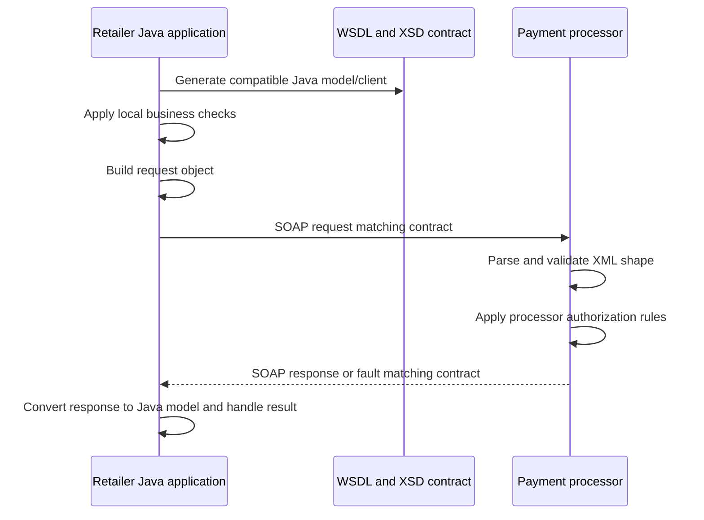
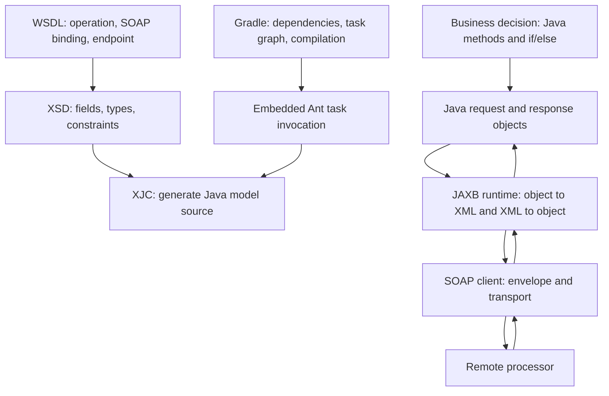

# Why Use WSDL, XSD, JAXB and Build-Time Generation?

## The short answer

You absolutely use normal Java code—`if` statements, classes, methods and tests—for the business rules. WSDL, XSD, JAXB and code generation solve a different problem: **how two independently built systems agree on the exact shape and meaning of data sent across a boundary**.

If a Java method is called inside one application, a Java interface and ordinary objects may be all you need. If your application must exchange messages with a bank, payment processor, insurer, government service or older enterprise system, the other side may not run Java, may be maintained by another team, and may require a formal XML contract. A shared contract makes that boundary explicit and machine-checkable.

These tools are not “more powerful ways to write `if`.” They are tools for **interoperability, agreement, validation, and repeatable translation**. They do not replace application logic.

## A real-time example: authorizing a card payment

Imagine a retailer checks out a customer. The retailer's application runs Java. Its payment processor runs a different system, managed by another company. The systems need to exchange a payment authorization request.

The retailer and processor must agree on details such as:

- which operation to call (`AuthorizeTransaction`)
- which fields are required (account/token, amount, currency, request time)
- the order and XML names used on the wire
- how amount and date/time values are represented
- which currency codes are allowed
- how an approval, decline or technical fault is represented
- the network protocol and service address

If these agreements exist only in a developer's Java class or a Slack message, both systems can make different assumptions. The retailer might send `amount` as a floating-point number in dollars while the processor expects an exact decimal in euros. One side might omit currency, or rename `accountNumber` to `payerAccount`. Both applications can compile successfully and still fail when the payment is actually sent.

### What each part contributes

| Need | Tool or technique | Payment example |
|---|---|---|
| Define the callable operation, messages, protocol and address | WSDL | `AuthorizeTransaction`, SOAP 1.2 binding, endpoint |
| Define legal XML fields and types | XSD | Required transaction ID, decimal amount, currency pattern, response status |
| Use Java objects for the XML shapes | JAXB | `TransactionAuthorizationRequestType` and response class |
| Turn the schema into Java source consistently | XJC, run by Ant/Gradle/Maven | Generate getters, setters, enum and XML metadata from XSD |
| Decide whether the payment is approved | Normal Java business logic | `if (amount > limit) decline; else approve;` |
| Send a SOAP message and handle the reply | SOAP client framework / transport | HTTP request, envelope, timeout, SOAP fault, response parsing |

### A contract-first exchange

The processor publishes a WSDL with an XSD contract. The retailer's build generates Java types from that schema. The retailer then builds a request object, a SOAP client serializes and sends it, and the processor validates and handles the request. Each side can implement its logic independently as long as it obeys the same contract.



## Why not just write Java classes and `if` statements?

You can—and you should—for logic that belongs inside the application. The concern appears when the Java class becomes the *only* definition of a cross-system agreement.

### 1. The other system may not be Java

The processor might be written in C#, COBOL, Java, or a commercial integration platform. A Java interface cannot be imported into those systems. XML and a published schema provide a language-neutral contract; each platform can generate or implement its own types.

### 2. The other team needs a stable agreement before implementation

With a contract, the retailer and processor can work in parallel. The retailer can generate a client and create mock responses before the processor finishes its code. The processor can validate sample requests against the same schema. The contract is reviewable and versionable.

### 3. Data shape and business rules are different responsibilities

An XSD can say that amount is a decimal, currency is three uppercase letters, a timestamp is present, and a field is optional. It generally cannot express the full payment decision, such as whether the account has funds, whether the card is blocked, or whether a merchant's risk score exceeds a policy threshold.

Those decisions remain normal code:

```java
if (accountIsBlocked(account)) {
    return decline("ACCOUNT_BLOCKED");
}

if (amount.compareTo(perTransactionLimit) > 0) {
    return decline("LIMIT_EXCEEDED");
}

return approve();
```

The schema helps ensure the request is shaped correctly before the decision logic processes it. It does not replace that logic.

### 4. Manual XML code is repetitive and fragile

Without a binding layer, code may build XML with string concatenation:

```java
String xml = "<Amount>" + amount + "</Amount>";
```

That looks easy until values contain XML-special characters, namespaces are required, optional fields appear, elements must stay in a defined order, dates need an exact format, or the schema evolves. Developers then write and maintain their own XML mapping and parsing logic—the work JAXB and generated classes already provide.

### 5. A contract catches some mismatches earlier

If the schema changes and generated code is refreshed, application compilation can reveal that a renamed or removed field is still referenced. Schema-aware validation can also catch malformed XML at the boundary. This shifts certain integration mistakes from production traffic to build time or message validation time.

Code generation does not catch every mismatch: runtime validation must be configured when required, and business semantics still need tests. It reduces duplicated mapping work; it does not make integration automatically correct.

## Why are there so many named technologies?

Each one owns a different layer. The stack sounds complicated because protocol, contract, data shape, Java mapping, and build execution are separate concerns.



### WSDL: what can I call and how?

WSDL is useful when a SOAP service must publish more than a data class. It describes the operation, its input and output, faults, SOAP binding and endpoint. A WSDL-aware generator can create service client stubs as well as data models.

### XSD: what data is legal?

XSD defines XML payload structure, types, order, required/optional elements, and selected constraints. It is useful when both sides need an unambiguous definition of valid XML.

### JAXB: how does XML map to Java?

JAXB maps XML data to Java types and back. XJC generates Java classes from XSD. A JAXB runtime marshals and unmarshals at runtime. JAXB does not send a request over the network.

### Ant and Gradle: how does the source get generated and compiled?

Ant and Gradle are build tools, not parts of SOAP itself. The build runs XJC, makes generated sources visible to Java compilation, resolves the right dependencies, and packages the application. This project's Gradle task invokes XJC through Ant's task API; there is no separate `build.xml` build.

## What happens in this project specifically?

The repository demonstrates only part of the payment integration story:

1. `wsdl/ESBTransactionAuthorization_v1_0.wsdl` describes a sample SOAP 1.2 service.
2. `wsdl/ESBTransactionAuthorization_v1_0.xsd` is the schema extracted from its WSDL types section.
3. Gradle's `genJaxb` task invokes Ant's XJC task against that XSD.
4. XJC writes JAXB model classes into `build/generated-sources/jaxb`.
5. Gradle adds that directory to the main Java sources and makes `compileJava` wait for generation.
6. `AuthorizationService` creates the generated request model, applies a local rule (amount strictly greater than 10,000 is declined), and creates a response model.
7. `AuthorizationController` accepts JSON and returns selected response fields as JSON.

It does **not**:

- generate SOAP service/port proxies from the WSDL
- marshal the request object into XML
- wrap the payload in a SOAP envelope
- make an HTTP call to the WSDL address
- receive or unmarshal a SOAP response

The project uses the contract and generated types to demonstrate a useful build pipeline, while its runtime authorization is a local simulation. That is why the generated request object can be present even though the business logic itself is ordinary Java.

### The Java rule still matters

The service's key decision is ordinary code:

```java
if (amount != null && amount.compareTo(BigDecimal.valueOf(10_000)) > 0) {
    response.setAuthorizationStatus(AuthorizationStatusType.DECLINED);
    response.setErrorMessage("Amount exceeds per-transaction limit");
} else {
    response.setAuthorizationStatus(AuthorizationStatusType.APPROVED);
    response.setAuthorizationCode(createAuthorizationCode());
}
```

The generated classes provide a Java representation of the agreed request and response fields. They do not make the decision. In a real SOAP implementation, a SOAP client would additionally serialize the request, send it and deserialize the processor's response.

## Is this complexity always worth it?

No. Choose based on the system boundary and the existing ecosystem.

| Situation | Usually suitable approach | Why |
|---|---|---|
| A small calculation inside one service | Normal Java methods and tests | No external data contract needs to be exchanged |
| Two services owned by the same team, modern HTTP/JSON | DTOs plus OpenAPI/JSON Schema as appropriate | A lighter contract often fits the API and toolchain |
| Existing partner mandates SOAP and publishes WSDL | WSDL/XSD, generated models/client, SOAP stack | The external contract and protocol are requirements |
| Many independent consumers use a long-lived XML format | Versioned XSD and generated bindings | A stable, language-neutral data contract reduces drift |
| One-off internal script with no shared contract | Direct code may be simpler | Formal schema/build machinery may cost more than it saves |

The right question is not “is Java code simpler than XML?” It is “what agreement does the boundary require, and who else must implement it?” If only your code calls your code, generated SOAP machinery may be needless. If a financial partner requires WSDL and SOAP, replacing it with Java-only classes does not remove complexity; it moves the complexity into undocumented assumptions and custom XML handling.

## A useful separation of responsibilities

Keep these questions distinct:

1. **Is the message structurally valid?** XSD and optional schema validation.
2. **Can Java represent it safely?** JAXB-generated model and Java types.
3. **Can the application communicate with the service?** SOAP client framework, transport, security and fault handling.
4. **Should the operation succeed?** Business logic and policy in Java.
5. **Can we build it repeatably?** Gradle/Ant/Maven, dependencies and generated-source task wiring.

Using `if`/`else` is entirely appropriate for question 4. It cannot by itself specify questions 1–3 for a different application or programming language, and it does not give the build repeatable generation for question 5.

## Takeaways

- Business rules remain normal Java code. Schemas and WSDL do not replace them.
- WSDL and XSD are valuable at system boundaries where independent implementations must agree.
- JAXB maps contract-shaped XML to Java; XJC generates the model source from XSD.
- A SOAP stack handles the actual envelope, network exchange, security and protocol faults.
- Ant/Gradle run build steps; they are not runtime SOAP technologies.
- This POC generates and uses JAXB model classes but simulates the remote decision and does not perform SOAP communication.
- Contract tooling is useful when it removes ambiguity and duplicated mapping. It is unnecessary overhead when no external contract or interoperability requirement exists.

## Further reading

- [Full project learning guide](SOAP_WSDL_XSD_JAXB_ANT_GRADLE_GUIDE.md)
- [Project architecture notes](02-architecture.md)
- [Jakarta XML Binding specification](https://jakarta.ee/specifications/xml-binding/4.0/jakarta-xml-binding-spec-4.0)
- [W3C XML Schema](https://www.w3.org/XML/Schema)
- [WSDL 1.1](https://www.w3.org/TR/wsdl.html)
- [SOAP 1.2](https://www.w3.org/TR/soap12/)

